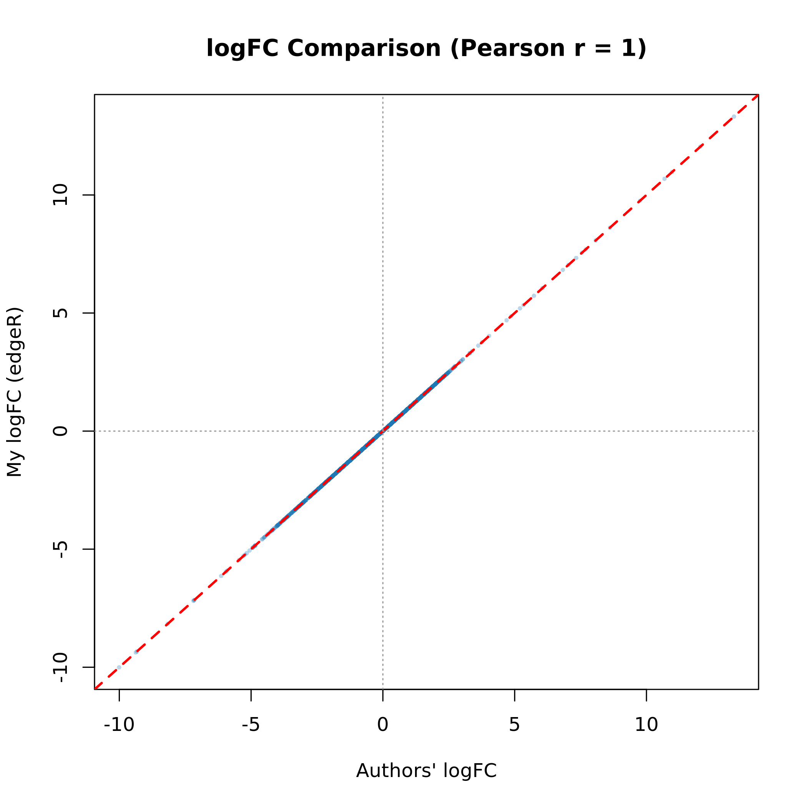

# Reproducing an RNA-seq differential expression analysis: APOE4 in human iPSC-derived cerebral organoids

Work in progress. This project independently reproduces the organoid RNA-seq analysis from Meyer et al. (2019), *Cell Reports* 26, 1112–1127 (GEO: [GSE117588](https://www.ncbi.nlm.nih.gov/geo/query/acc.cgi?acc=GSE117588)), first from the authors' count table and then from the raw sequencing reads, and tests how robust the published result is.

## Roadmap

- [x] Reproduce the published edgeR result from the authors' count table (target: 16,581 expressed genes, 5,141 at FDR < 0.05)
- [ ] Independent check with DESeq2 (R and PyDESeq2); Benjamini–Hochberg implemented and verified
- [ ] Raw reads to counts with Salmon; comparison with the authors' and NCBI's counts
- [ ] Reproducible Snakemake workflow, tests and fresh-clone check
- [ ] Robustness: how much the result depends on any single sample

## The study

APOE4 is the strongest common genetic risk factor for late-onset Alzheimer's disease. Meyer et al. took an iPSC line carrying APOE4 and gene-edited it to APOE3, the common neutral variant. Because both lines come from the same person, they are isogenic: differences between them should mostly reflect APOE itself rather than different genetic backgrounds. Both lines were grown into cerebral organoids and profiled by RNA sequencing, three samples per genotype.

The authors aligned reads with STAR to GRCh38 (Ensembl release 92), kept genes with at least 1 count per million in at least 3 samples, normalised with TMM, and tested for differential expression with edgeR's likelihood ratio test. They report 5,141 genes at FDR < 0.05 (Table S6).

## Week 1: reproducing the published edgeR result

**Notebooks:** `notebooks/01_inspect_counts.ipynb` (Python) and `notebooks/02_edger_reproduction.ipynb` (R)

### Checking the data first

Before any analysis, I checked the authors' count table:

- 58,395 genes × 6 samples, matching the number of annotated genes stated in the paper
- Ensembl gene IDs with no version suffixes, so they match Table S6 directly
- whole-number counts only, as edgeR requires
- library sizes of 9.1–13.0 million counted fragments per sample
- 23,791 genes (about 41%) with no reads in any sample, as expected for a single tissue type

The count columns use the authors' sample names (ADR_5 to ADR_14), not GEO accessions, and they aren't ordered by genotype. I matched each column to its genotype through the GEO sample titles, recorded in `metadata/samples.csv`, and checked the matching in code rather than relying on column order. An early version of my code matched samples by position, which silently assigned three samples to the wrong group; matching by name fixed it.

### Results

| Checkpoint | Paper | This reproduction |
|---|---|---|
| Genes after filtering | 16,581 | **16,581** |
| Significant genes (FDR < 0.05) | 5,141 | 5,127 |
| Higher in APOE4 | 2,457 | 2,454 |
| Lower in APOE4 | 2,684 | 2,673 |

**Filtering matched exactly,** confirming the data, sample labels and filtering rule were all reproduced correctly.

**Fold changes were identical.** Across all 16,581 genes, my log fold changes and the authors' have a Pearson correlation of 1.000.

**Significant genes overlapped almost completely.** 5,102 genes were significant in both analyses: 99.2% of the paper's significant genes, and 99.5% of mine. The 64 genes that differ (39 significant only in the paper, 25 only in my analysis) all have FDRs between 0.045 and 0.056 in both analyses. They sit on the 0.05 threshold and tip to one side or the other.

**The likely cause is the software version:** the authors used edgeR 3.20.9 (2017), and I used edgeR 4.10.7. Since fold changes are identical, the small difference must come from p-values, which depend on dispersion estimation, an area that has been updated across edgeR versions. Running the original version would confirm this definitively.

### What the data look like

- **Replicates are consistent:** the biological coefficient of variation is 0.165, meaning replicates typically differ by about 16.5% in expression.
- **The genotypes separate clearly.** In the MDS plot, the first dimension explains 75% of the variation and completely separates APOE4 from APOE3. A second, smaller dimension (9%) separates one APOE3 sample, ADR_6, from the other two, which I'll revisit in the robustness analysis.
- **TMM normalisation factors** range from 0.92 to 1.05, with all APOE4 samples near 1.05 and all APOE3 samples below 1, consistent with the large number of genes that differ between the groups.

## Data

The data are not included in this repository. To reproduce the analysis, download into `data/`:

- `GSE117588_organoids-gene-counts.tsv.gz`, the authors' count table, from the [GEO page](https://www.ncbi.nlm.nih.gov/geo/query/acc.cgi?acc=GSE117588)
- Table S6 from the paper's supplementary materials, saved as `meyer2019_tableS6_organoid_DEGs.xlsx`

Sample information is in `metadata/samples.csv`.

## Software

R with edgeR 4.10.7 and readxl; Python with pandas. The environment is managed with conda.

## Reference

Meyer K, et al. (2019). REST and neural gene network dysregulation in iPSC models of Alzheimer's disease. *Cell Reports* 26, 1112–1127. https://doi.org/10.1016/j.celrep.2019.01.023

AI tools were used for code review and debugging.